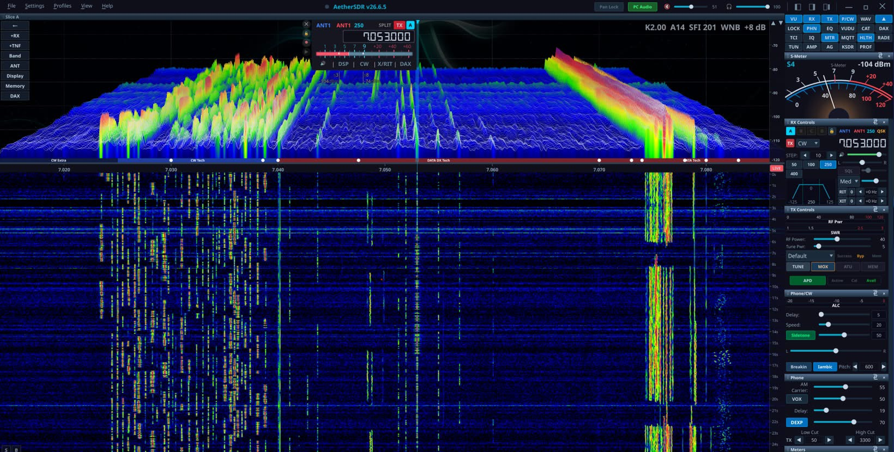

# AetherSDR

**An open-source radio client for Linux, macOS, and Windows**

[](https://github.com/aethersdr/AetherSDR/actions/workflows/ci.yml)
[](https://www.gnu.org/licenses/gpl-3.0)
[](https://en.cppreference.com/w/cpp/20)
[](https://www.qt.io/)
[](https://github.com/aethersdr/AetherSDR/commits/main)

AetherSDR implements the SmartSDR protocol for FlexRadio transceivers and
supports [additional radios](#supported-hardware). It is built with Qt 6 and
C++20 and runs natively on all three platforms, including Raspberry Pi and
other aarch64 Linux systems.

**Current version: 26.11.3** — CalVer (`YY.M.patch[.hotfix]`). | [Download](https://github.com/aethersdr/AetherSDR/releases/latest) | [Discussions](https://github.com/aethersdr/AetherSDR/discussions) | [What's New](https://github.com/aethersdr/AetherSDR/releases)



---

## Highlights

- **GPU-accelerated spectrum and waterfall** — QRhi rendering (OpenGL, Metal, or D3D11) with a per-pixel spectrum trace and an FFT input rate of up to **60 fps**. Options include FFT Smooth, De-comb, a **3D stacked-trace** mode, and GPU adapter selection. Slice flags are composited on the GPU.
- **Multi-slice & multi-panadapter** — colour-coded VFO overlays, independent TX assignment, diversity/ESC beamforming, and up to 8 detachable pans with native VITA-49 waterfall tiles and per-flag S-meter / **SmartMTR** views
- **KiwiSDR and Web-888 public-receiver browser** — find and connect to public receivers worldwide through an API-policy-aware directory, with diversity receive and receive-only TX inhibit
- **AetherTX and AetherRX** — the transmit and receive chains, one window each. AetherTX is the channel strip (tube, EQ, compressor, AetherVoice exciter, reverb and a look-ahead brickwall limiter, on by default) behind RNNoise mic denoising, with a preset library and scope; AetherRX puts noise reduction, gate, EQ, compressor, tube, AetherVoice and the output meter on tabs down its left edge
- **Seven client-side noise-reduction engines** — NR2 (spectral), RN2 (RNNoise), NR4 (libspecbleach), NNR (WDSP Neural Noise Reduction), DFNR (DeepFilterNet3), BNR ([NVIDIA Maxine](docs/nvidia-bnr.md) on a local RTX GPU on Linux and Windows), and MNR (macOS). The engines process left and right audio independently to preserve stereo panning and diversity.
- **DAX virtual audio + IQ** — up to 8 RX audio channels (radio-dependent) plus 1 TX, and 4 channels of raw I/Q at 24–192 kHz for WSJT-X / fldigi / VARA / JS8Call, with a per-slice **WFM demodulator** for satellite data
- **AetherModem packet radio** — KISS-over-TCP TNC, connected-mode AX.25 BBS, a personal mailbox, a WIDE1-1 fill-in digipeater, and an **APRS client** (station table, GPS beacon, messaging) on a Direwolf-derived VHF demodulator, plus a receive-only **HF Data** monitor for Data2G
- **AetherLab** — an experimental vector network analyzer workspace for the RigExpert Stick Pro over USB, a proof of concept with hardware sweeps qualified on one Stick Pro 108 on macOS: SWR, return loss, impedance and series/parallel R, X, L and C with markers and JSON session export
- **AetherSweep** — in-panadapter SWR analyzer with log scale, threshold-band shading and interpolated bandwidth at SWR ≤ 1.5 / 2.0
- **AetherWSPR** — a receive-only WSPR receiver that runs on the radio itself (FLEX-8000 and Aurora as a container, FLEX-6000 as a legacy waveform), with its spots in SpotHub, on the panadapter and on AetherMap, and optional WSPRnet upload
- **SpotHub** — DX Cluster, RBN, WSJT-X, POTA, FreeDV Reporter, N1MM+/DXLog contest bandmap, the EiBi shortwave schedule and the KiwiSDR DX Community database, with auto-mode switch and per-feed colouring
- **Local voice keyer** — twelve PC-microphone recordings up to 30 seconds each, with preview, import/export and F1–F12 playback; radio DVK remains available separately
- **CW operator suite** — ggmorse plus download-on-demand DeepCW and DeepFist receive decoders where ONNX Runtime is available (ggmorse only on Intel macOS), MIDI/keyboard straight-key and iambic paddles with full QSK, optional Quindar tones
- **Copy Assist (speech-to-text)** — on-device transcription of received voice via whisper.cpp, docked under the waterfall with confidence colour-coding, optionally from the audio before noise reduction. CPU or GPU (Vulkan/Metal, auto-detected), download-on-demand models, optional remote OpenAI-compatible endpoint. Not in the Intel macOS build — see [`docs/asr-copy-assist.md`](docs/asr-copy-assist.md)
- **FreeDV RADE** — AI digital-voice codec with a client-side neural encoder/decoder
- **AetherMap (PSK Reporter) overlays** — optional global precipitation (LibreWXR, with NOAA, ECCC and EUMETNET OPERA regional radar backups and a per-provider legend), NOAA/NWS weather radar with observation playback ([`docs`](docs/psk-reporter-weather-radar.md)) and a NASA/GSFC VIIRS night-lights layer that fades through civil twilight ([`docs`](docs/psk-reporter-city-lights.md)), on both the 2D map and 3D globe
- **SmartLink** — remote FlexRadio operation over the internet using Auth0 and TLS.
- **Tailscale remote access** — connect to a radio behind carrier-grade NAT. Tailscale runs in a container on FLEX-8000 and Aurora radios and as a legacy waveform on FLEX-6000 radios. Sign in with a QR code. End-to-end testing with AetherSDR is pending for FLEX-6000. [Setup guide](docs/user/docs/tailscale-remote-access.md)
- **TCI server** — CAT, audio, I/Q, CW, spots, tune events, and receiver events over a single WebSocket. The server announces protocol version 2.1.
- **Keyboard and MIDI actions from one registry** — band, mode, slice, panadapter, memory, antenna, filter, RIT/XIT and transmit actions, each bindable to a key and a MIDI control
- **Broad hardware control** — rigctld and virtual-serial CAT, OTRSP two-slice focus for contest loggers, MIDI mapping, the FlexControl knob, serial PTT/CW keying, Multi-Flex operation alongside SmartSDR/Maestro, a CTR2-Max relay over Wi-Fi or USB that serves several USB controllers at once with negotiated spectrum and CW-text extensions for compatible controllers, and touch gestures (pinch-zoom, press-and-hold, kinetic scrolling) on touch screens
- **Workspace canvas** — arrange resizable panadapters and applets across windows, with layering and edge or grid snapping. Named workspaces restore open applets and their positions and can be assigned to radio profiles. The canvas is off by default.
- **A user guide at [docs.aethersdr.com](https://docs.aethersdr.com)** — Stable and Next versions, a printable PDF manual signed with each release, and a Log Analyzer that reads a log or support bundle in your browser without uploading it
- **In-app updates** — a check at launch, at most once a day, that lights an UPDATE badge in the title bar, and an Updates window (File → Update...) that installs the new release as AetherSDR exits — on Windows, on macOS, and on Linux from an install made with Install for updates or `AetherSDR --install` — alongside the radio's firmware releases
- **Built-in demo mode** — a synthetic backend generating its own RX audio and matching panadapter, with a fault-injection harness, so you can explore the full UI with no radio attached (it cannot transmit)

---

## How AetherSDR Is Built

Project lead Jeremy KK7GWY and the core team primarily use Claude Code,
which the project recommends for contributors.
Contributors also use Codex, Copilot, Cursor, Gemini, and Aider.
[AetherClaude](https://github.com/aethersdr/aetherclaude) triages issues,
drafts implementation plans, and opens pull requests for issues labelled
`aetherclaude-eligible`.

The [Constitution](CONSTITUTION.md) defines the project's engineering
principles and follows the structure of [Cisco's Foundry Constitution](https://github.com/CiscoDevNet/foundry-security-spec).
[`AGENTS.md`](AGENTS.md) gives coding assistants project-specific
instructions. The [Contributors graph](https://github.com/aethersdr/AetherSDR/graphs/contributors)
lists contributors by commit attribution.

---

## Supported Hardware

| Radio | Status | Details |
| --- | --- | --- |
| FLEX-6000 series | **Supported** | FLEX-6300, FLEX-6400, FLEX-6400M, FLEX-6500, FLEX-6600, FLEX-6600M, FLEX-6700 |
| FLEX-8000 series | **Supported** | FLEX-8400, FLEX-8400M, FLEX-8600, FLEX-8600M |
| Aurora series | **Supported** | AU-510, AU-510M, AU-520, AU-520M |
| FlexRadio ML, CL, and RT series | **Supported** | |
| [Hermes-Lite 2](docs/user/docs/hermes-lite-2.md) | **Supported** | Desktop app. Gateware 74, openHPSDR Protocol 1. |
| [Icom IC-7300MK2](docs/user/docs/networked-icom.md) | **Supported** | Built-in Ethernet via RS-BA1 |
| Icom IC-705 | Experimental | Hardware-qualified over Wi-Fi via RS-BA1 |
| Icom IC-9700 | Experimental | Hardware-qualified over Ethernet via RS-BA1 |
| Icom IC-7851 | Experimental | Hardware-qualified over Ethernet via RS-BA1 for MAIN/SUB control, scope, and receive audio |
| Icom IC-7610 and IC-7760 | Experimental | Ethernet via RS-BA1. Hardware qualification pending. |
| [ANAN-G2](docs/user/docs/anan-g2.md) | Experimental, receive-only | Ethernet via openHPSDR Protocol 2 |
| [RTL-SDR](docs/user/docs/rtl-sdr.md) | Experimental, receive-only | USB dongles supported by `librtlsdr` |

The FlexRadio firmware baseline is 4.x. The primary test target is a
FLEX-8600 running firmware 4.2.18 (SmartSDR protocol v1.4.0.0).

On compatible Icom models, Scroll-F holds the displayed frequency range
while you tune within it and scrolls when you reach an edge. See the
[Networked Icom guide](docs/user/docs/networked-icom.md#panadapter-scope-modes)
for model and firmware requirements.

Official packages include RTL-SDR. It opens one panadapter and one
receiver by default. On supported test platforms, an opt-in automation
setting enables two, four, or eight receivers for evaluation.

### Amplifiers, tuners, and antenna switches

- 4O3A/FlexRadio PGXL, TGXL, and Antenna Genius use the device's access code
  for direct connections.
- ACOM S-series and SPE Expert 1K-FA, 1.3K-FA, 1.5K-FA, and 2K-FA
  amplifiers connect over serial or ser2net TCP.
- VK3AMP 600 W, 1000 W, and 2000 W models use TCP for control and UDP for
  telemetry.
- Elecraft KPA1500 uses TCP. Hardware validation is pending.
- RF-KIT uses its HTTP API. Hardware testing covered the RF2K-S.
- Elecraft KPA500, KAT500, and KXPA100/KXAT100 connect over local serial or
  raw TCP and offer Full and Mini applets and Advanced maintenance controls.

## Tested Controller Devices

AetherSDR supports external station-control hardware through USB serial, USB HID,
MIDI, and generic USB-serial adapters:

- FlexRadio FlexControl USB tuning knob
- Icom RC-28 USB remote encoder
- Griffin PowerMate USB knob
- Contour ShuttleXpress and ShuttlePro v2 jog controllers
- MIDI controllers with learn mode, manual mapping entry, importable/exportable profiles (including vendor-supplied SmartSDR `.map` files), and relative-encoder support
- AetherPad — an Arduino Giga R1 running the [aether-pad](https://github.com/nigelfenton/aether-pad) RC-28 emulator firmware; over USB HID (hidapi builds) it drives the same RC-28 controls and LEDs
- Ulanzi Dial Bluetooth HID dial on Linux, Windows (hidapi builds) and macOS, its rotary and buttons mapped in Settings → Ulanzi Dial Mapping...
- Elgato Stream Deck+ natively over USB HID (hidapi builds), driving the LCD keys and the four encoder dials
- ELAD/WoodBoxRadio TMate 2 over USB HID (hidapi builds): three encoders, nine keys, and the LCD and backlight
- Other Stream Deck models require control-surface software that connects to AetherSDR through TCI or the automation bridge.
- USB-serial PTT/CW interfaces for foot switches, straight keys, iambic paddles,
  amplifier keying lines, and external sequencers

---

## Download

Pre-built binaries are available from [Releases](https://github.com/aethersdr/AetherSDR/releases/latest):

| Platform | Download | Notes |
|----------|----------|-------|
| **Linux x86_64** | `AetherSDR-*-x86_64.AppImage` | Single file, no install needed. `chmod +x` and run. |
| **Linux ARM** | `AetherSDR-*-aarch64.AppImage` | Raspberry Pi, ARM laptops. `chmod +x` and run. |
| **macOS Apple Silicon** | `AetherSDR-*-macOS-apple-silicon.dmg` | Apple Silicon (M1+), macOS 14.4 or newer. Signed & notarized. |
| **macOS Intel** | `AetherSDR-*-macOS-intel.dmg` | Intel Macs, macOS 14.4 (Sonoma) or newer. Signed & notarized. |
| **Windows Installer** | `AetherSDR-*-Windows-x64-setup.exe` | Setup wizard with Start Menu shortcut and uninstaller. |
| **Windows Portable** | `AetherSDR-*-Windows-x64-portable.zip` | No install needed. Extract and run. |

---

## Building from Source

Source builds require **Qt 6.12 or later**. Release builds use the version
pinned by the setup script. Run `scripts/setup/setup-qt.sh` on Linux or macOS
or `scripts/setup/setup-qt.ps1` on Windows to install the pinned Qt and
qtkeychain. CMake finds the installation automatically. See the
[build guide](docs/BUILDING.md#the-release-qt-setup-qtsh) for setup details
and instructions for using a system Qt.

See [BUILD-OPTIONS.md](BUILD-OPTIONS.md) for compile-time switches, defaults and
prerequisites, including optional decoders and experimental radio backends.

### Dependencies

Install system dependencies with your platform's package manager. The
[build guide](docs/BUILDING.md) lists optional packages and the features
they enable.

```bash
# Arch / CachyOS / Manjaro
sudo pacman -S cmake ninja pkgconf autoconf automake libtool python curl git \
  fftw rtl-sdr portaudio hidapi \
  libpulse libglvnd fontconfig libsecret wayland libxkbcommon-x11 pipewire \
  xcb-util-cursor xcb-util-image xcb-util-keysyms xcb-util-renderutil xcb-util-wm

# Debian / Ubuntu / Linux Mint
sudo apt install cmake ninja-build pkg-config autoconf automake libtool \
  python3 python3-venv curl git \
  libfftw3-dev librtlsdr-dev portaudio19-dev libhidapi-dev \
  libgl1-mesa-dev libpulse-dev libasound2-dev libpipewire-0.3-dev pipewire-bin \
  libdbus-1-dev libglib2.0-dev libsecret-1-dev libfontconfig1-dev libfreetype6-dev \
  libx11-dev libx11-xcb-dev libxcb1-dev libxkbcommon-dev libxkbcommon-x11-dev \
  libxcb-cursor0 libxcb-glx0 libxcb-icccm4 libxcb-image0 libxcb-keysyms1 \
  libxcb-randr0 libxcb-render-util0 libxcb-shape0 libxcb-sync1 libxcb-util1 \
  libxcb-xfixes0 libxcb-xinerama0 libxcb-xkb1 \
  libopengl0 gstreamer1.0-pulseaudio gstreamer1.0-plugins-base

# Fedora
sudo dnf install cmake ninja-build autoconf automake libtool python3 curl git \
  fftw3-devel rtl-sdr-devel portaudio-devel hidapi-devel \
  libglvnd-devel pulseaudio-libs-devel fontconfig-devel freetype-devel \
  dbus-devel glib2-devel libsecret-devel libX11-devel libxcb-devel \
  libxkbcommon-devel libxkbcommon-x11-devel \
  xcb-util-cursor xcb-util-image xcb-util-keysyms xcb-util-renderutil xcb-util-wm

# macOS (Homebrew); Qt needs Xcode 16 — see docs/BUILDING.md
brew install ninja cmake pkgconf autoconf automake libtool \
  fftw librtlsdr portaudio hidapi
```

### Build & Run

```bash
git clone https://github.com/aethersdr/AetherSDR.git
cd AetherSDR
scripts/setup/setup-qt.sh            # Qt 6.12 (cached per user) + qtkeychain
cmake -B build -G Ninja -DCMAKE_BUILD_TYPE=RelWithDebInfo
cmake --build build -j$(nproc)
./build/AetherSDR
```

RADE-enabled builds use the Opus source bundled with AetherSDR.

### Install (optional, Linux)

```bash
sudo cmake --install build
```

The installed application uses Qt from the build configuration. After
upgrading Qt, rebuild and reinstall AetherSDR before removing the old Qt
installation.

The [build guide](docs/BUILDING.md) covers Windows and macOS setup, GPU
rendering, the `AETHER_NO_GPU` option, and Wayland and XWayland.

---

## Roadmap

- **aetherd** — separate the radio engine from the desktop UI. The daemon
  supports local receive control, bounded telemetry, credential-scoped Flex
  PTT, and paired remote clients for receive. The desktop sends typed requests
  through `IRadioBackend` for controls such as slice tuning, Radio Setup,
  panadapter settings, CW, profiles, and memories. Remaining work includes
  routing updates to individual clients, expanding transmit support, and
  building a UI client that connects to the daemon.
- **Radio backends** — see [Supported Hardware](#supported-hardware) for
  current support and the roadmap for work planned by radio family.
- **Workspace canvas** — add live dragging between windows and test the
  canvas and Classic shell on real stations.
- **UI style guide** — migrate windows and dialogs to the
  [AetherSDR style guide](docs/style/aethersdr-style-guide.md) (RFC #6226).
  Update the shared theme defaults after the individual migrations.
- **AppSettings** — migrate legacy flat settings into versioned, per-radio
  feature documents stored in SQLite.
- **Flathub submission** — prepare the Flathub manifest and submit the pull
  request. The project already includes AppStream metadata and a man page.

See [`ROADMAP.md`](ROADMAP.md) for planned work and the
[issue tracker](https://github.com/aethersdr/AetherSDR/issues) for individual
reports and requests.

---

## Contributing

Pull requests, bug reports, and feature requests are welcome. Pull requests to
`main` require signed commits, passing CI, and CODEOWNERS review. See
[CONTRIBUTING.md](CONTRIBUTING.md) for submission guidelines and the
[commit signing guide](docs/COMMIT-SIGNING.md) for SSH and GPG setup.

**Not a developer?** Choose **Help → Submit your Idea... 💡** in AetherSDR to create an AI-assisted bug report or feature request.

---

## Related projects

- **[Aether-gate](https://github.com/aethersdr/Aether-gate)** — a receive-only
  bridge for Hamlib-compatible CAT radios, Icom LAN radios, and SoapySDR
  devices. It implements the FlexRadio interface to provide a live panadapter,
  waterfall, and frequency and mode control in AetherSDR. By Nigel
  Fenton (G0JKN); GPL-3.0-or-later. *(`aethersdr/Aether-gate` tracks upstream
  [nigelfenton/Aether-gate](https://github.com/nigelfenton/Aether-gate).)*

For native Icom connectivity, see the [Networked Icom guide](docs/user/docs/networked-icom.md).

---

## Verifying Downloads

Linux and Windows binaries are GPG-signed. macOS artifacts are Apple notarized. Each release includes `SHA256SUMS.txt` and its signature `SHA256SUMS.txt.asc`, which covers every file listed.

```bash
curl -sSL https://raw.githubusercontent.com/aethersdr/AetherSDR/main/docs/RELEASE-SIGNING-KEY.pub.asc | gpg --import
gpg --verify SHA256SUMS.txt.asc SHA256SUMS.txt
sha256sum -c --ignore-missing SHA256SUMS.txt
```

From v26.11.4, per-file `.asc` signatures are at `https://updates.aethersdr.com/releases/vX.Y.Z/` (on the release page for its first few hours).

See [docs/VERIFYING-RELEASES.md](docs/VERIFYING-RELEASES.md) for full instructions.

---

## License

AetherSDR is free and open-source software licensed under the [GNU General Public License v3](LICENSE).

Bundled third-party libraries retain their own licenses (see each `third_party/<lib>/LICENSE`), all GPLv3-compatible. Notably, on-device speech-to-text uses **[whisper.cpp](https://github.com/ggml-org/whisper.cpp) and ggml** (MIT) — vendored under `third_party/whisper.cpp/` (Vulkan/Metal GPU backends included); Whisper model weights are downloaded on demand and are MIT-licensed, not redistributed in this repository.

*AetherSDR is an independent project and is not affiliated with or endorsed by FlexRadio Systems.*
*D-STAR is a registered trademark of Icom Inc. AetherSDR is not affiliated with or endorsed by Icom Inc.*
