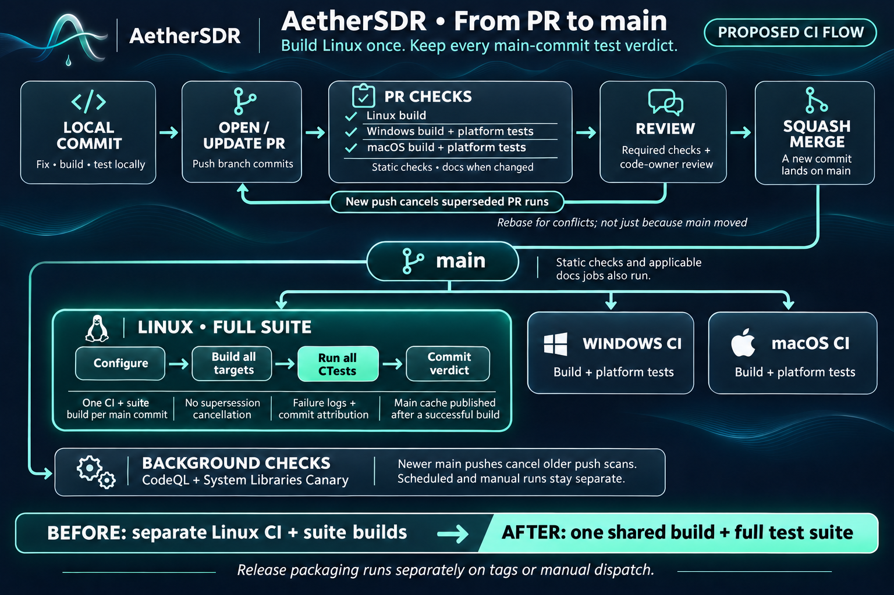

# PR Workflow

How changes move through review and land on `main`: draft conventions,
the stale-branch policy, and recovery when post-merge CI goes red.

*Who* must approve *what* is policy and lives in
[`CONTRIBUTING.md`](../CONTRIBUTING.md#reviews-and-merging), backed by
[`.github/CODEOWNERS`](../.github/CODEOWNERS). This document covers the
mechanics around that gate, not the gate itself.

---

## Draft PR conventions

Draft status carries different meaning depending on who opened the PR:

- **Human-authored draft** — work-in-progress; reviewers should skip
  these until the author marks Ready for Review.
- **`@AetherClaude` / `aethersdr-agent[bot]` draft** — auto-generated
  from an issue and **awaiting human review**. The draft state holds
  the PR back from auto-merge; it is not "WIP". Treat it like a
  ready-to-review PR for triage purposes.

Triage scripts and review agents should include bot drafts in their
sweep and skip only human drafts.

---

## Stale-branch policy

We **do not** require PR branches to be up to date with `main` before
merging. The reasoning:

- Squash-merge already runs a fresh three-way merge against `main`, so
  textual conflicts are caught at merge time regardless of branch age.
- Forcing every PR to rebase after every other merge cost ~15–25 min
  of CI per stale PR per batch day, which adds up fast when AetherClaude
  is processing a queue of triaged issues.
- Post-merge validation runs on every commit: Windows/macOS in
  [CI](../.github/workflows/ci.yml), and the Linux build plus all registered
  tests in [Full Suite](../.github/workflows/full-suite.yml). These runs keep
  each commit's verdict, so semantic conflicts are checked on the merged
  result. The separate CodeQL and system-library canary push runs allow a
  newer main commit to supersede an older scan.

---

## CI from PR to main

A branch push to an open PR starts Linux, Windows and macOS validation plus
static checks and applicable documentation jobs. A newer push to that PR
cancels its superseded runs. Build new tests locally: the Linux PR gate builds
production targets, and the full test suite runs after merge.

After the squash merge, every main commit gets its own **Full Suite** run:
configure, build the entire Linux default graph once, then run unfiltered,
serial CTest. Full Suite is the sole writer of the shared Linux compiler and
DeepFilterNet caches. Its cache saves run after testing when compilation
succeeded, even if a test failed; that preserves the warm build cache without
changing the red test verdict. Failed builds and cancelled/manual runs do not
publish these caches. Cache cleanup follows Full Suite completion.

The Linux `build` job in CI is PR-only; it is skipped on main. Windows and
macOS retain their post-merge CI runs. Full Suite has no supersession
cancellation or shared concurrency group: another merge cannot discard an
older commit's full-suite verdict or failure attribution.

CodeQL and the system-library canary retain their independent builds. Their
main-push groups cancel superseded scans, while scheduled/manual groups stay
separate. Release packaging remains a separate tag/manual path.

---

## Recovering from a red main

If post-merge CI on `main` fails after a merge:

1. Check the failing workflow run linked from the email/GitHub
   notification. Identify the offending merge commit.
2. **Prefer fix-forward** if the issue is small (one or two file edits):
   open a normal PR titled `fix(ci): repair main after <SHA>` and let
   it land through the usual flow.
3. **Use revert** if fix-forward isn't obvious or the regression is
   broad: `git revert -m 1 <merge-sha>` on a new branch, push, open a
   PR, merge. Never force-push `main`.
4. For agent-authored regressions: re-open the source issue, remove
   the `aetherclaude-eligible` label, then re-add it. The orchestrator's
   State Override C (`failed` → `implement` re-entry) creates a fresh
   worktree from current `main` and retries the implementation.
