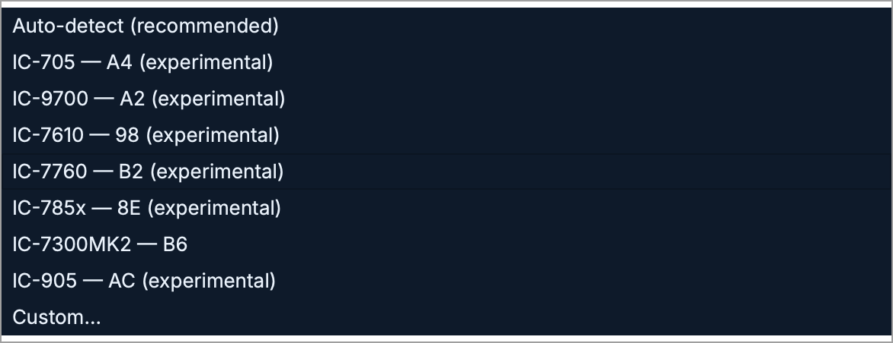
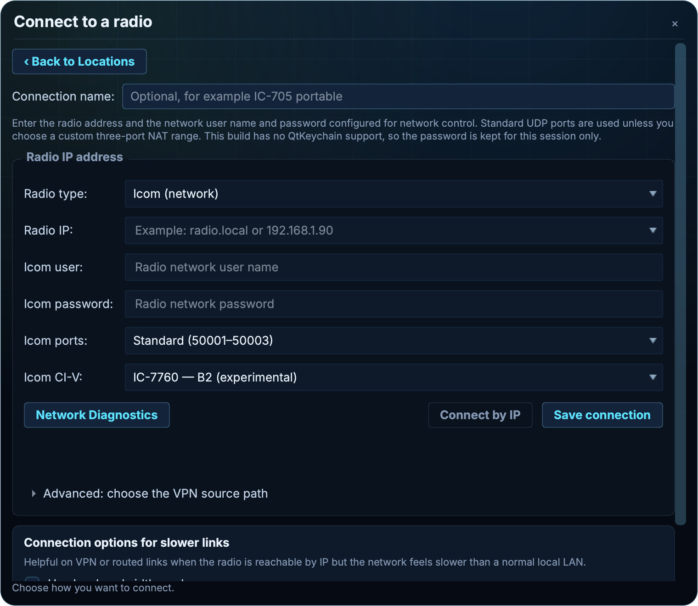

# IC-7610 and IC-7760 initial Ethernet bring-up

The implementation target is two fixed MAIN/SUB receivers with native display
traces, demodulated receive audio, and one shared transmitter over RS-BA1/CI-V.
It is experimental and requires target-radio qualification. Offline fixtures
prove parsing and routing, not firmware interoperability or RF performance.

## Protocol authority

The implementation follows the operator's Icom oracle, sections 13.2–13.6 and
13.13, checked against these locally retained primary documents:

- [IC-7610 CI-V Reference Guide](https://www.icomjapan.com/support/manual/1745/),
  A7380-7EX-4, September 2025, pp. 13–15 and SET-menu tables.
- [IC-7760 CI-V Reference Guide](https://www.icomjapan.com/support/manual/4227/),
  A7788-8EX-2, May 2025, pp. 23–26 and SET-menu tables.
- The oracle's pinned wfview protocol research supplies the stereo PCM codec
  identifier. No source code is copied from wfview.

The CI-V identity reply selects the hardware profile, independently of a
customized command address. The canonical model is published through RadioModel
and its infoChanged signal, which refreshes the status-bar model label. Names
supplied by an operator do not select a
hardware profile. Profiles record official-guide evidence separately from live
hardware evidence. `verified` in the identity table means the documented facts
were checked, not that this app was tested on that hardware.

## Implemented boundary

| Area | Initial contract |
| --- | --- |
| Topology | Slice/pan 0 is MAIN; slice/pan 1 is SUB. Both are fixed resources. Pans are published before their slices. The IC-9700 retains its existing single selectable scope. |
| Frequency | `25 rr` reads/writes absolute MAIN/SUB. A selected-band transceive push prompts addressed reconciliation; it cannot overwrite an arbitrary receiver cache. |
| Mode | `26 rr` retains base mode, DATA OFF/D1/D2/D3 and FIL1/FIL2/FIL3. Writes carry all fields and use an addressed readback. The existing neutral mode vocabulary collapses the DATA variant in the displayed label; the backend retains the actual enum. |
| Other receiver controls | Only explicitly supported command families use `29 rr`. Shared PTT, split, modulation menus and scope commands are not wrapped. Generic ACK/NG is serialized by the existing scheduler. MAIN and SUB use separate semantic generations. |
| Scope | Two independent decoders, 689 amplitudes each, documented 0–200 range. Each normal Ethernet sweep has 704 data bytes after `27 00`, including 15 metadata bytes. Truncated/oversized traces and invalid selectors are rejected. Out-of-range clears only its receiver. |
| Frequency axes | Center mode is centre ± half-span. Fixed and scroll modes report actual lower/upper edges. Bytes already run from low to high RF; there is no IQ conjugation or FFT half-rotation. RadioModel derives spectrum and waterfall from the same bins and geometry. |
| Zoom | Center mode snaps to the eight native spans, 5 kHz–1 MHz total width. Fixed/scroll views preserve radio edge presets; arbitrary preset editing is deferred. |
| RX audio | Stereo PCM16 RX and mono PCM16 TX are negotiated independently at 48 kHz. Stereo packet fragments retain complete interleaved frames. Candidate mapping is channel 0 MAIN/channel 1 SUB, pending a target-model capture. Each receiver has its own persistent 48→24 kHz converter and decoder feed. Speakers get a bounded equal mix with local per-slice gain/mute/balance. |
| LAN AF/IF | Read-only inspection of the model's AF/IF menu. IF is not played as demodulated AF. No connect-time menu rewrite. IC-7610 item 86; IC-7760 item 123. |
| TX routing | One global PTT and one mono uplink. Editing focus does not move TX. Radio split readback selects MAIN or SUB; `1C 03` reports actual TX frequency. Key-on waits for receiver frequency/mode and split readback. Existing operation admission, queued-audio cancellation, PTT readback and fail-safe unkey remain in place. |
| Modulation | IC-7610 LAN=05, DATA OFF item 91, D1/D2/D3 items 92/93/94. IC-7760 LAN=09, DATA OFF item 129, D1/D2/D3 items 130/131/132. Diagnostics follow the actual transmit receiver's DATA variant. PC Audio continues to change DATA OFF only on operator request. |

Stereo negotiation uses the advertised factory CI-V destination as a transport
hint, not as authorization for model-specific controls. An explicit model choice
also requests stereo; `icom.rxChannels=1/2` can override the receive transport
for an automated connection using a customized address. An unknown identity
never gains TX or scope capability from that hint. Mono sessions publish no
invented SUB audio feed and warn that SUB audio is unavailable.

## Connection dialog integration

This branch integrates PR #6889, including its dependency #6885. Icom model
choices retain the existing CI-V hex userData and saved-path/Location behavior.
The chooser uses the same experimental-support policy as the radio-tab strip:
IC-7610 and IC-7760 are experimental; IC-7300MK2 retains its supported status.
The integration build is stacked on those pending PRs.

## Offline verification

`icom_dual_receiver_test` injects decoded frames into an unstarted production
session: no radio sockets, synthetic radio service, or physical transmitter.
It exercises both profiles at a custom address, both scope IDs and full native
bin counts/positions, independent axes, out-of-range and malformed frames,
foreign/stale deliveries, reordered MAIN/SUB state, DATA enums, split/focus,
receiver-qualified confirmations, stereo decoder feeds and the speaker mix.
The same dual-receiver test captures the production uplink writer without
opening sockets. It checks mono PCM packet duration and stereo downmix level,
24→48 kHz conversion after the resampler's acoustic delay, rejection while
unkeyed or without audio authority, and cancellation of queued audio on unkey
for both models. This proves host packet production, not target-radio TX.

`icom_audio_test` checks byte/frame boundaries across stereo packets and channel
counts for loss concealment. Existing Icom tests protect the previous models.

## Minimum hardware acceptance

Before testing, check the radio owner/busy state and the local test lock. Do not
connect over another operator's session. Record model, firmware, connection
address, AF/IF menu, Dualwatch, scope display selection, codec and sample rate.

1. Connect in RX. Identify the correct model at default and customized CI-V
   addresses. Confirm command replies remain live during both scope streams.
2. Enable Dualwatch/dual scope on the radio if necessary. Observe distinct MAIN
   and SUB traces, 689 bins each, with separate frequency, span, REF and history.
3. Inject or tune identifiable signals at center and both sides. Confirm peak,
   waterfall column, click tuning and received tone agree on both receivers.
   Test Center, Fixed and both scroll metadata forms. Change spans independently.
4. Send different audio markers to each receiver. Establish actual LAN channel
   ordering, rate, gain/squelch behavior and effects of Dualwatch/XFC. Verify
   both decoder feeds and the monitor mix; mute one without interrupting its
   decoder feed. Confirm AF selection resolves any IF-like listening symptom.
5. With explicit TX authorization and an appropriate load, test low-power PTT
   and mono uplink in voice and data modes. Confirm RF/audio at the intended
   MAIN/SUB frequency for split off/on. Change editing focus without changing
   RF routing. Verify PTT readback and physical unkey on release/disconnect.
6. Reconnect and repeat after a transport interruption. Old scope/audio buffers,
   pending commands and TX authority must not cross the new session.

Archive the bridge snapshots, received CI-V trace, audio markers, screenshots
and the independent RF observation. Do not describe the devices as qualified or
close #6871/#6872 from offline tests alone.

## Deferred work and core transport risks

Receiver-specific DSP, true user-programmed filter widths/PBT, all antenna
combinations, meter calibration, PSK labels, CW text, memories, DPD/inhibit UI,
firmware-specific extensions and LAN IF demodulation are outside this initial
bring-up. This Ethernet path supplies amplitude traces and AF, not wideband IQ.
The radio's own TX inhibit/interlocks remain authoritative; the app does not
clear them.

The oracle also flags broader pre-existing RS-BA1 work: fixed-size single-record
capability parsing, advertised/configured media-port reconciliation, busy-owner
handling before stream acquisition, and model-specific open/restart behavior.
These are not proven causes of the current reports and should be investigated
with actual target captures before changing the shared transport.

Useful next automation verbs would report per-receiver scope freshness/bin
geometry, capture identified audio channels, and assert the global TX route
against actual TX-frequency readback. They should consume real observations,
not manufacture a radio session or elevate offline fixtures into hardware proof.

## UI evidence

The connection dialog images were captured through the automation bridge from
an isolated, disconnected app with TX automation disabled. The badges below
are offline `TitleBar` fixtures for the canonical identities, not connected
hardware screenshots.

