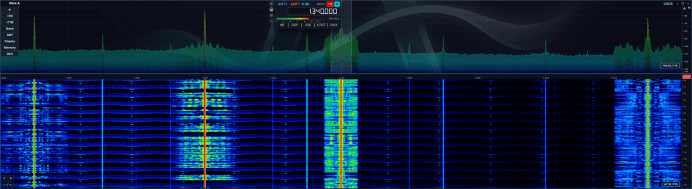
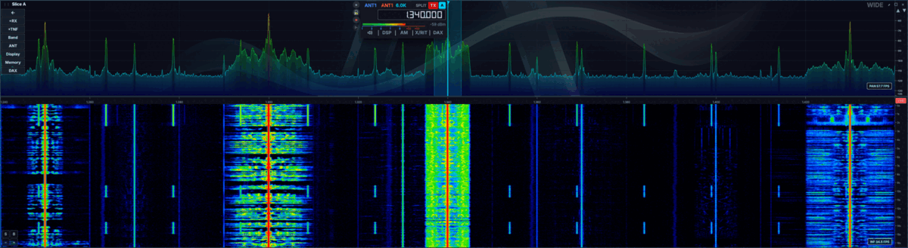

# Backing-store and redraw comparison

This change reduces repeated top-level QWidget image copies on macOS and avoids scheduling fresh pan textures after a window update has already been queued. It also skips standard VFO meter redraws whose integer bar pixels have not changed. Radio/model delivery, numeric labels and elapsed-time meter ballistics are preserved.

## Results

| Workload | CPU % before → after | Pan 0 /s | Pan 1 /s | Delivered drag /s | Samples before / after |
|---|---:|---:|---:|---:|---:|
| GPU · stationary 2D | 86.4 → 65.2 | 34.4 → 52.7 | 34.4 → 52.7 | — | 2 / 2 |
| GPU · matched 12 Hz drag | 100.2 → 84.2 | 37.0 → 50.8 | 27.5 → 50.8 | 12.0 → 12.0 | 2 / 2 |
| GPU · maximum-rate drag | 100.2 → 87.5 | 37.2 → 48.1 | 24.6 → 48.1 | 26.1 → 59.9 | 1 / 1 |
| GPU · stationary 3D | 64.2 → 44.3 | 24.0 → 30.4 | 24.0 → 30.4 | — | 1 / 1 |
| Software · stationary 2D | 107.8 → 107.5 | 12.7 → 11.8 | 12.7 → 11.8 | — | 3 / 3 |
| Software · requested 12 Hz drag | 109.1 → 108.6 | 10.8 → 10.2 | 10.8 → 10.2 | 6.1 → 5.9 | 2 / 1 |
| Software · matched 5 Hz drag | 108.9 → 108.4 | 11.2 → 10.3 | 11.2 → 10.3 | 4.9 → 4.9 | 1 / 2 |

## Method

Measured 2026-11-12 on Apple M5, 32 GB RAM, the pinned Qt 6.12.0 kit (202609280346), and a Studio Display at 60 Hz. The main window is maximized at 2880 × 1534 logical pixels, DPR 2. Two Flex panadapters and two receivers at **1.340 MHz, AM**, 6 kHz filters; FFT FPS 60 and Waterfall Rate 100. The observed radio input is about 58.4 FFT frames/s and 24.8 waterfall rows/s per pan. One app and one radio client run during each sample. No transmit operations.

CPU is process CPU: **100% means one logical core**. GPU counts are fresh pan renders; software counts are QPainter paint events, including partial widget repairs, and **are not full-frame FPS**. Pan 0 is actively tuned in drag tests. These counters are distinct from the incoming PAN FPS label and from screen presentation latency.

Each interval lasts 24–25 seconds after warmup, with counters reset. The GPU baseline is the saved prior comparison app using its existing QPainter VFO renderer; Canvas is not selected. The software baseline restores the original VFO and pan scheduler implementations in the same GPU-disabled build configuration. Build, screenshot and profiler work occur outside timed samples. Matched drags use a four-second sinusoidal path, ±96 logical pixels, at 12 Hz for GPU and 5 Hz for software; the dial is restored after each run. Overload runs request 60 Hz on GPU or 12 Hz on software and report the rate actually delivered, so they compare throughput rather than equal input work.

The GPU 2D baseline ranged from 78.0% to 94.9% CPU; both numbered samples are retained. Software stationary testing includes a restart of each variant. Other live-signal and event-timing variation remains; these are bounded observations on one Mac, not Windows measurements or a synthetic whole-machine saturation test.

## Copy and GPU profiling

Qt image copy/detach stacks: **231.2 → 126.9 sampled CPU ms/s** (45% lower). Inclusive backing-store stacks: **362.8 → 308.5 ms/s**. App GPU active interval union: **360.1 → 296.1 ms/s**.

Each Metal System Trace lasts 15 seconds; analysis uses seconds 1–14. Inclusive categories overlap and must not be added. These are sampled costs, not copy-byte counters; GPU active interval union is app activity across engines, not whole-device utilization. Raw process-environment metadata is excluded from exported evidence.

The [Qt 6.12 compositor](https://github.com/qt/qtbase/blob/v6.12.0/src/gui/painting/qbackingstoredefaultcompositor.cpp) detaches the source image before dirty-region upload. This patch reduces duplicate composition work around that cost; it does not patch Qt itself.

## Limits and defaults

The final default deliberately enables window pacing for shared QRhi windows on **Windows, Linux and macOS**. This includes software QRhi drivers (software OpenGL, WARP, llvmpipe); they use the same Qt composition path. This is a cross-platform scheduling change, not a macOS-only optimization. Native-child QRhi windows and `AETHER_GPU_SPECTRUM=OFF` QPainter builds keep their original pan timer. Immediate scheduling reduced the QPainter paint-event rate to about 9/s without a CPU saving, so it is excluded from that configuration. QPainter CPU is essentially unchanged; its modestly lower paint-event count cannot establish a full-frame throughput change without damage-region telemetry. A fresh restart measured 12.16 paint events/s for the original QPainter build and 12.03 for the final build.

Windows and Linux already use shared composition; the new default changes their update scheduling. The Mac CPU percentage must not be projected onto either platform. Software OpenGL/WARP on Windows was not benchmarked. `repaintScheduling off` permits a transient comparison with the old scheduling on any platform. The existing native-window diagnostic override on macOS remains available; no automatic renderer fallback is added.

## macOS native-window workaround

Shared Metal composition is the default for **every supported macOS GPU build**. CMake requires Qt 6.12, so there is no supported older-Qt branch. `AETHER_PAN_NATIVE_WINDOW=1` explicitly restores a native child surface per pan, with ancestor isolation paired with it. The former `AETHER_PAN_NO_NATIVE_WINDOW` opt-out is obsolete because shared composition is now the default.

The original report is [AetherSDR #702](https://github.com/aethersdr/AetherSDR/issues/702), and [PR #714](https://github.com/aethersdr/AetherSDR/pull/714) introduced the explicit Metal API and native NSView workaround for a QRhiWidget left without a usable Metal surface. The report also records two application/build fixes: chaining `QRhiWidget::resizeEvent` and eliminating mixed Homebrew/aqt Qt libraries. It does not identify an upstream Qt bug or a Qt 6.12 fix release.

The required [Qt 6.12 implementation](https://github.com/qt/qtbase/blob/v6.12.0/src/widgets/kernel/qwidget.cpp#L10880-L10923) evaluates the reparented widget's RHI requirements, recreates the nearest native parent when its surface type differs, and creates backing-store RHI support when the type already matches. Qt's [per-surface RHI/compositor change](https://github.com/qt/qtbase/commit/eb4cb719257d3b57cd801273d4011579d8c81714) documents that mechanism and references QTBUG-119221, QTBUG-121181 and QTBUG-120096. That change predates Qt 6.12; it is supporting implementation history, not evidence that AetherSDR #702 was first fixed in 6.12.

On the pinned Qt 6.12.0 stack, the original blank/no-initialization symptom no longer reproduces without the native-child guard: both pans initialize Metal, render fresh frames, and retain valid textures after float/dock, 2D/3D switches and maximize/restore. That source evidence and live validation support retiring the guard as the default on the supported stack. The evidence establishes working behavior on the tested Mac, not the first Qt release containing a fix or performance on every Mac/GPU.

## Validation

Both GPU and `AETHER_GPU_SPECTRUM=OFF` app builds pass with eight build jobs. Four focused CTests pass: `window_repaint_scheduler_test`, `vfo_meter_overlay_invalidation_test`, `vfo_flag_placement_test`, and `native_widget_topology_test`. Removing the coalescing guard and unchanged-pixel guard makes the corresponding tests fail; restored sources pass.

These tests are registered in `tests/tests.cmake` for the full suite on pushes to `main` and the sanitizer lanes. The repository's frozen per-PR test allow-list does not execute them; their local results are reported separately from PR build/static checks. See [test/CI policy](../agents/tests-ci.md).

Live bridge checks cover the intended display/geometry, single client, receiver mode/frequency, max requested stream rates, actual drag tuning, renderer health, float/dock, maximize/restore, and GPU texture extents after settling. The software path is verified as `gpu: false`. Invalid `repaintScheduling` values are rejected. Documentation production build, generated references/bridge docs, log-rule checks, test registration/CI gate, and engine boundary/command-plane checks pass locally. Cross-platform CI is still required before merge.

## Automation follow-ups

Added `repaintScheduling on|off`, `get repaintstats [reset]`, and screen metadata in `window` replies. Repaint statistics count QWidget update-request delivery, not presentations or copy bytes. The existing render statistics also expose bounded QRhi submission-interval samples; those include compositions that reuse a pan texture.

A useful next addition is timestamped `gestureReplay` with delivered-event counters, plus `paintDamageStats` reporting software full/partial paint coverage. Those would separate bridge round-trip limits and partial repairs from real pan frame throughput.

## Screenshots

GPU run, captured from the maximized setup (PAN FPS is the incoming data rate):

Software run at the same size and receiver settings:

The [CSV](backing-store-redraws.csv) retains per-scenario sample counts, CPU ranges and event rates; the [JSON](backing-store-redraws.json) provides the same summary for automation.
